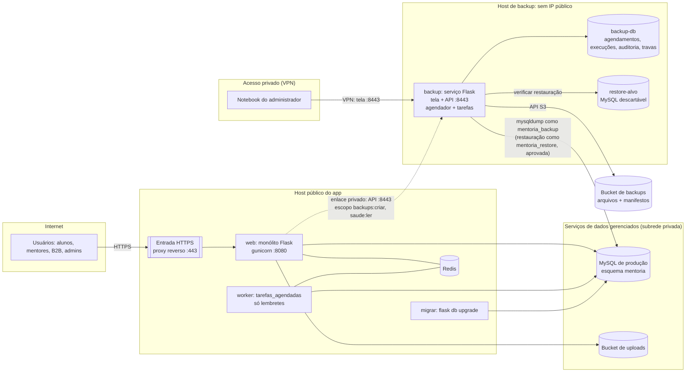
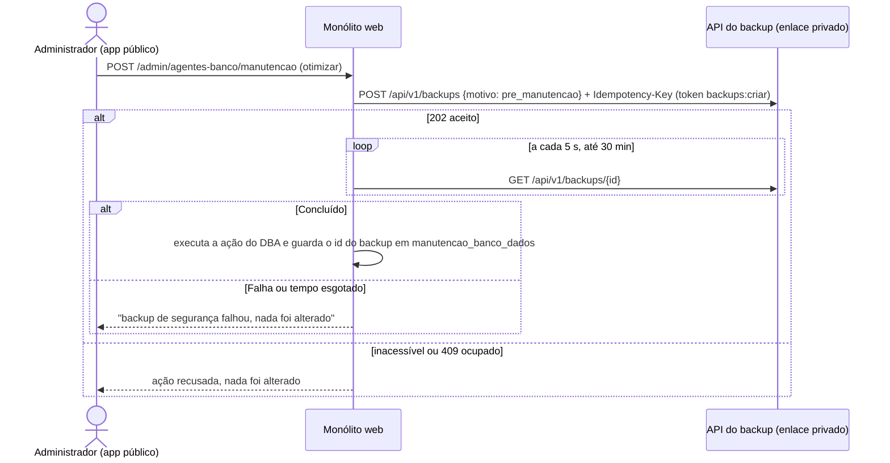

# Migração da Plataforma de Mentoria para microsserviços — propostas das Fases 1 a 4

**Situação:** a Fase 1 foi executada localmente (branch `refatoracao-fase1`, commit `56a4654`, **sem push**). As Fases 2, 3 e 4
são **propostas aguardando aprovação**: nenhum repositório foi criado, nada foi extraído, removido ou publicado e nenhuma
infraestrutura de produção foi alterada.

Base analisada: `origin/cloud-native` @ `eed79cb` (contém tudo o que está em `main`; ver decisão D1).

Marcadores usados no texto:
- **[verificado]**: lido no código ou exercitado por teste nesta sessão;
- **[proposto]**: contrato ou comportamento novo;
- **[incerto]**: depende de uma decisão ou de infraestrutura que não aparece no repositório.

Sumário: [Fase 1](#fase-1--inspeção-linha-de-base-e-refatoração-local) ·
[Fase 2](#fase-2--fronteiras-de-serviço-proposta) ·
[Fase 3](#fase-3--implementação-da-migração-plano) ·
[Fase 4](#fase-4--documentação-e-verificação-plano) ·
[Decisões pendentes](#decisões-pendentes) · [Pedido de aprovação](#pedido-de-aprovação)

---

# Fase 1 — Inspeção, linha de base e refatoração local

## 1.1 Acesso ao repositório

- Não havia cópia local. O repositório `luiskenji-ido/plataforma-mentoria` é público e foi clonado **somente para leitura**:
  esta sessão não tem permissão de push (ver D2).
- Branches remotas: `main`, `adequacoes-b2b`, `cloud-native` e `infra-painel`.
  - `cloud-native` (21/11/2026) tem tudo o que está em `main`; falta só o commit de merge da `adequacoes-b2b`, cujo conteúdo
    ela já inclui.
  - Ela soma 19 commits a mais: CI, pytest, ruff, Dockerfile em dois estágios, docker-compose (MySQL, Redis e MinIO), arquivos
    em S3, sondas de saúde, MFA e login pelo Google.
  - `infra-painel` tem um commit próprio (painel Pulumi em `infrastructure/`), fora do escopo.
- Base escolhida: `cloud-native`, para não refazer esse trabalho (decisão D1).

## 1.2 Inventário [verificado]

| Área | O que existe | Onde |
|---|---|---|
| Aplicação | Flask monolítico. O `app.py` tinha 10.823 linhas e 179 rotas (agora são 10.614 linhas e 176 rotas) | `app.py` |
| Dados | 75 tabelas num único esquema, 137 chaves estrangeiras (84 delas para `usuario.id`), Alembic | `models.py`, `migrations/` |
| Bancos suportados | SQLite, MySQL/MariaDB, PostgreSQL e SQL Server | `banco_config.py`, `ambiente.BANCOS` |
| Autenticação | Flask-Login com sessão, bcrypt, MFA TOTP, códigos de recuperação, login pelo Google, primeiro acesso, troca obrigatória de senha, perguntas de segurança | `app.py:100-420`, `autenticacao.py` |
| Autorização | Regras nomeadas `PERFIS_*`; perfis personalizados bloqueiam endpoints por módulo | `app.py:100-135`, `perfis_acesso.py` |
| Segurança web | CSRF, CSP, limite de tentativas de login (memória ou Redis), sanitização de HTML, cabeçalhos | `seguranca_web.py` |
| Arquivos | Disco local ou S3/MinIO, por chaves relativas | `armazenamento.py` |
| Tarefas em segundo plano | Worker `tarefas_agendadas.py --continuo`: lembretes, bancas, avaliações, backups, aprendizado dos agentes, catálogo de IA, requisições de mudança | `tarefas_agendadas.py` |
| Integrações | Google (Agenda, Gmail, SSO), Microsoft 365, SMTP, provedores de IA (Anthropic, OpenAI, Gemini), Redis, S3 | `microsoft365.py`, `convites_reuniao.py`, `email_smtp.py`, `provedores_ia.py` |
| Agentes de IA e de QA | Subprocessos locais iniciados pela web: OmniTest (Playwright), segurança, banco, funcionalidades e Orquestrador (corrige código e faz commit) | `agentes_*/`, `app.py:8887…9420` |
| Operação | `/healthz`, `/readyz`, logs JSON, encerramento gracioso com SIGTERM, gunicorn | `saude.py`, `logs_estruturados.py`, `gunicorn.conf.py` |
| Implantação | Dockerfile, docker-compose (local e simulação de EC2), guias para AWS, Azure, GCP, PythonAnywhere e Ubuntu | `Dockerfile`, `docker-compose*.yml`, `deploy/` |

### Backup e restauração hoje [verificado]

| Item | Detalhe |
|---|---|
| Tela | `/admin/banco` (Sistema › Manutenção (DB)). Ações do formulário: `backup`, `novo_agendamento`, `editar_agendamento`, `pausar`, `retomar`, `executar`, `excluir`, `restaurar`, `limpar` (zona de perigo) e `limpar_auditoria` |
| Outras rotas | `/admin/banco/arquivo` (download), `/admin/banco/relatorio/<tipo>.csv` (auditoria) e `/admin/ambiente/backups-padrao` |
| Permissão | `PERFIS_ADMINISTRACAO_SISTEMA = ['Administrador']` e o módulo `manutencao` dos perfis personalizados |
| Motor | `backup_servico.py`: SQLite pela API de backup, MySQL por `mysqldump --single-transaction` em `.sql.gz`, PostgreSQL por `pg_dump` em `.dump`. Integridade conferida, retenção por agendamento e cópia opcional fora do servidor (`BACKUP_DIR_EXTERNO`) |
| Dados | Tabelas `agendamento_backup`, `alteracao_agendamento_backup` e `registro_backup`, preservadas na restauração (`TABELAS_PRESERVADAS`); arquivos em `BACKUP_DIR/<pasta>/` |
| Agendamento | Pode disparar em **três** lugares: o `before_request` de cada worker web (a cada 5 min), a thread `rotina_de_backups` (quando roda `python app.py`) e o worker de tarefas |
| Quem também usa | DBA (`banco_manutencao._backup_antes`), Agente de Funcionalidades (backup antes dos testes), Agente Backup e Recuperação (testa a restauração em cópia temporária), `conhecimento_banco`, `instalar.py` (agendamentos padrão) e tela *Ambiente* |

Lacunas encontradas:
- não existe o estado "restauração verificada";
- os arquivos enviados (uploads) não entram no backup;
- a restauração roda dentro do processo web ativo;
- a imagem pública leva o `mysqldump` e credenciais com poder total sobre o banco.

## 1.3 Linha de base

| Verificação | Comando | Resultado |
|---|---|---|
| Lint | `ruff check .` | ✅ limpo |
| Formatação | `ruff format --check …` (lista do CI) | ✅ |
| Unidade | `pytest tests/unit -q` | ✅ 170 passaram |
| Integração (MySQL 8.4 via Testcontainers) | `pytest tests/integration -q` | ✅ 34 passaram |
| Imagem | `docker build -t mentoria .` | ✅ (com a imagem base da sandbox, ver abaixo) |
| Ponta a ponta | `pytest tests/e2e -q` | ⚠️ 7 passaram, **4 já falhavam antes** |

As 4 falhas ponta a ponta que já existiam:
1. **Saúde do contêiner ainda `starting`:** corrida com o intervalo de 30 s do HEALTHCHECK.
2. **Cabeçalho `Server` com `gunicorn`:** o gunicorn sobrescreve o `Server: Mentoria` definido em `seguranca_web.py:363`.
3. **Login com 429:** o teste anterior de limite de tentativas deixa o contador no Redis compartilhado (dependência de ordem entre testes).
4. **Download cortado no SIGTERM.**

Pré-requisitos do ambiente:
- Python 3.12, Docker, `mysql-client` (para os testes de backup) e acesso a `deb.debian.org`.
- `deb.debian.org` foi liberado no ambiente *Default* desta conta.
- Nesta sandbox, a imagem foi construída a partir de uma base que conhece o proxy local. Essa base fica fora do repositório.

## 1.4 Refatoração feita (sem mudar comportamento nem URLs)

| Mudança | Arquivos | Motivo |
|---|---|---|
| Regras puras do backup (sem Flask, banco ou disco): validação do agendamento, próxima execução, retenção, saúde e prefixos dos arquivos | `backup_regras.py` (novo); `backup_servico.py` delega e mantém os mesmos nomes | Separa regra de negócio de infraestrutura; vai inteiro para o serviço |
| Rotas de backup fora do `app.py` (215 linhas a menos), com os mesmos URLs e endpoints e uma função por ação | `rotas_backup.py` (novo); `app.py` só registra | Fronteira clara: na Fase 3, a remoção é um módulo e uma linha |
| **Correção:** reserva atômica do agendamento vencido (UPDATE condicional) | `backup_servico.reservar_execucao` | Dois processos podiam rodar o mesmo backup |
| **Correção:** `mysqldump` e `mysql` usam TCP como o app, a não ser que a URL tenha `unix_socket` | `backup_servico._arquivo_de_credenciais` | Com `localhost` e MySQL só por TCP, backup e restauração falhavam. O teste novo falhou antes da correção |
| **Correção:** binários (`.docx`, `.png` …) marcados como `binary` | `.gitattributes` | A regra `deploy/** text eol=lf` alterava os bytes desses arquivos |
| Testes novos: 26 de unidade (com 400 casos aleatórios comparados a uma referência de força bruta) e 9 de integração em MySQL (permissões, agendamento, retenção, corrida e restauração de ponta a ponta) | `tests/unit/test_backup_regras.py`, `tests/integration/test_backup_http.py` | Registram o comportamento atual antes da extração |
| Lista de formatação do CI e referências de arquivo dos agentes | `.github/workflows/ci.yml`, `agentes_omnitest/*.py` | Ferramentas apontando para os arquivos certos |

Resultado depois da refatoração:

| Verificação | Resultado |
|---|---|
| Lint e formatação | ✅ |
| Unidade | ✅ 196 passaram |
| Integração | ✅ 43 passaram |
| Varredura de regras nomeadas | ✅ 0 regras escritas direto no código |
| Imagem e checagens do CI | ✅ sem segredos, sem testes, uid 10001; não sobe sem `SECRET_KEY` |
| Ponta a ponta | ⚠️ as mesmas 7/4 da linha de base (nenhuma regressão) |

Ficou para a migração aprovada:
- os três pontos de disparo do agendamento;
- a posse das 3 tabelas;
- a remoção da tela e das permissões de backup;
- a zona de perigo.

---

# Fase 2 — Fronteiras de serviço (proposta)

## 2.1 Evidências [verificado]

| Fato | Consequência |
|---|---|
| Esquema único com 137 chaves estrangeiras, 84 delas para `usuario`; 40 módulos importam `models` | O domínio de negócio é um modelo de dados só. Dividi-lo exigiria consultas distribuídas e sagas em cada tela |
| Uma equipe, um deploy, nenhum sinal de ciclos de entrega independentes | Separar o negócio não traz independência de deploy |
| O backup já trata as próprias 3 tabelas como **fora** dos dados restaurados (`TABELAS_PRESERVADAS`) | O código já pede que os metadados do backup fiquem fora do banco que é restaurado: dono de dados diferente |
| O backup exige credencial de dump e restauração, os binários `mysqldump`/`pg_dump` e escrita em disco ou bucket | Hoje, um contêiner web comprometido pode copiar e sobrescrever todo o banco |
| A restauração roda numa requisição web | Restaurar produção deve ser operação aprovada e feita fora da web |
| Os agentes de IA e de QA importam o app inteiro e o Orquestrador edita o código com git | São ferramentas acopladas ao código, não capacidade de produção |

## 2.2 Recomendação: extrair **um** serviço

| Capacidade | Dono do negócio | Dono dos dados | Deploy independente? | Custo operacional | Decisão |
|---|---|---|---|---|---|
| Backup, restauração, agendamentos, indicadores e verificação de restauração | Administração do sistema / operação | 3 tabelas + arquivos | Sim: outro host, outra rede, outras credenciais | 1 serviço + 1 host + VPN, compensado pelo isolamento | ✅ **separar** |
| Domínio de negócio (cursos, mentoria, TCC, bancas, reuniões, avaliações, B2B, certificados, notificações) | Gestão pedagógica / B2B | Esquema único | Não | Muito alto | ❌ manter junto |
| Autenticação e autorização | Idem | `usuario`, MFA, perfis | Não | Alto | ❌ manter; o backup terá login **próprio** |
| Lembretes (`tarefas_agendadas.py`) | Idem | Esquema único | Já é processo separado | — | ❌ manter, sem o job de backup |
| Assistente, provedores de IA, base de conhecimento | Administração | Tabelas próprias com FK para `usuario` | Sem evidência | Médio | ❌ manter (rever se custo ou escala divergirem) |
| Agentes de IA e de QA | Dev/QA | Leem tudo | Precisam do código e do git | Alto | ❌ manter; candidatos a sair do host público no futuro |
| Ações do DBA | Administração | Banco de negócio | Não | — | ❌ manter; **chamam** o serviço para o backup prévio |

## 2.3 Repositórios propostos (em `LK-Plataforma-Mentoria`)

| Repositório | Papel |
|---|---|
| `mentoria-backup` | Serviço privado de backup e restauração com tela de administração (Flask, a mesma pilha) |
| `mentoria-ecossistema` | docker-compose do ecossistema, documentação de arquitetura, diagramas, contratos de API (OpenAPI) e roteiros de operação |
| `luiskenji-ido/plataforma-mentoria` (existente) | Monólito: ganha o cliente da API atrás de uma flag e depois perde a tela, as rotas e os jobs de backup (D2) |

## 2.4 O serviço `mentoria-backup` [proposto]

- **Responsabilidade:**
  - backups manuais, agendados e prévios (pedidos pelo monólito);
  - retenção e armazenamento dos arquivos;
  - verificação de restauração num alvo descartável;
  - restauração de produção, com aprovação separada;
  - indicadores e trilha de auditoria (quem iniciou, escopo e resultado).
- **Módulos de origem:**
  - regras e motor: `backup_regras.py`, `backup_servico.py`, `copiar_banco.py`;
  - tela: `rotas_backup.py` e `templates/admin_banco.html`;
  - pastas e ferramentas: `ambiente.pasta_backups*` e `ambiente.ferramenta_backup`;
  - teste de restauração de `agentes_banco/agente_backup.py`.
- **Dados próprios:**
  - MySQL 8.4 no host de backup, com as tabelas `agendamento`, `alteracao_agendamento`, `execucao`, `trava`,
    `verificacao_restauracao`, `aprovacao` e `operador`;
  - bucket **exclusivo** de backups com as chaves `<pasta>/<arquivo>` de hoje e um manifesto JSON por arquivo
    (sha256, tamanho, motor, revisão do Alembic, quem pediu e por quê).
- **Estados:** `Em andamento` → `Concluído` (dump gravado e íntegro, como hoje) → `Verificado` (restaurado no alvo descartável e
  conferido) ou `Falha`. Os indicadores mostram "último backup" e "último backup verificado".
- **Conflitos:**
  - uma tarefa por vez para cada banco-alvo, controlada por uma linha de trava com prazo e batimento;
  - um segundo pedido recebe `409 Conflict`;
  - os agendamentos continuam com a reserva atômica da Fase 1.
- **Interfaces:**
  - tela privada (porta 8090 local e 8443 com TLS no host);
  - API privada `/api/v1/*`;
  - `GET /healthz` (vida) e `GET /readyz` (banco próprio e bucket; o banco de produção é informado na resposta, mas não impede a prontidão).

## 2.5 Autenticação, autorização e fluxos preservados

- **Hoje:** só `Administrador` (e perfis personalizados com o módulo `manutencao`) usa `/admin/banco`, o download e os relatórios.
- **No serviço:** contas de operador **próprias**, com senha e TOTP obrigatório (porta do `autenticacao.py`). O motivo: se o banco
  do monólito for o problema, ainda é preciso entrar no serviço para restaurá-lo. Papéis:
  - `auditor`: indicadores, histórico e relatórios;
  - `operador`: backup manual, agendamentos, verificação de restauração e download;
  - `restaurador`: pede a restauração de **produção**, que só roda depois da aprovação de **outro** restaurador e apenas a partir
    de backup `Verificado`.
  - As contas são criadas pela linha de comando no host (`flask --app servico operadores criar …`).
- **Entre serviços:**
  - o monólito usa um token com os escopos `backups:criar backups:ler saude:ler`;
  - nunca restaura, apaga ou baixa;
  - o token é assinado (HMAC), trocado periodicamente e usado só por TLS; mTLS é opcional (D7).
- **No banco de produção:**
  - usuário `mentoria_backup`, só de leitura para o dump (SELECT, SHOW VIEW, TRIGGER, EVENT, LOCK TABLES, PROCESS e SHOW_ROUTINE);
  - usuário `mentoria_restore`, com poder total só no esquema `mentoria`, carregado apenas durante uma restauração aprovada.
- **Para o administrador:** as mesmas ações, campos e relatórios CSV, mais "Verificar restauração" e o passo de aprovação. Muda o
  endereço: a tela passa a ser acessada pela VPN.

## 2.6 Comunicação

**Redes:**
- **Local (uma máquina):** nomes DNS de serviço em redes Docker:
  - `rede_publica`: só a porta da `web` é publicada;
  - `rede_app`: web, worker, migrar, db, redis e minio;
  - `rede_backup`: backup, backup-db, restore-alvo e backup-migrar;
  - `rede_entre_hosts`: backup, db, minio e web; **simula** o enlace privado entre os hosts.
- **Produção [incerto: D7]:** o DNS do Docker não atravessa hosts. O host de backup **não tem IP público**. Um túnel WireGuard
  (ou VPN da nuvem / subrede privada) leva três fluxos, e o firewall libera só eles:
  - host do app → `backup.mentoria.interno:8443`;
  - host de backup → banco de produção `:3306` e bucket de backups;
  - notebooks dos administradores (pares da VPN) → `backup.mentoria.interno:8443`.

| # | Quem chama → quem responde | Gatilho | Sínc./assínc. | Método e rota / evento | Tempo-limite, novas tentativas e falha |
|---|---|---|---|---|---|
| 1 | Navegador do admin (VPN) → tela do backup | Backup manual, agendamentos, histórico, relatórios, download | síncrono | `GET/POST /admin/banco`, `GET /admin/banco/arquivo`, `GET /admin/banco/relatorio/<tipo>.csv` | Dump longo vira tarefa (sem o limite de 180 s da requisição) |
| 2 | Monólito (DBA, agente de funcionalidades) → API | Backup antes de ANALYZE/OPTIMIZE/índices | início síncrono + consulta periódica | `POST /api/v1/backups` com `Idempotency-Key` → `202 {id}`; `GET /api/v1/backups/{id}` | Conexão em 3 s; POST repetido 2× só em erro de conexão; consulta a cada 5 s por até 30 min. Fora do ar, 409 ou `Falha` → **a ação do DBA é recusada e nada muda** (mesma regra de hoje) |
| 3 | Monólito (tela *Ambiente*, agentes de banco, base do assistente) → API | Indicadores e agendamentos, só leitura | síncrono | `GET /api/v1/saude`, `GET /api/v1/agendamentos` | Tempo-limite de 2 s, sem nova tentativa, cache de 60 s; na falha, a tela mostra "serviço de backup inacessível". **Opcional** |
| 4 | Agendador do backup → banco de produção | Agendamento vencido | assíncrono (tarefa) | `mysqldump` por TCP como `mentoria_backup` | Banco fora: execução `Falha`, indicador `Crítica`, e-mail. Próxima tentativa só no próximo vencimento |
| 5 | Tarefa → bucket | Guardar arquivo e manifesto | assíncrono | S3 `PutObject` e depois `HeadObject` (tamanho e sha256) | 3 tentativas com espera crescente; na falha, guarda a cópia local e registra `Falha` |
| 6 | Tarefa → alvo descartável | "Verificar restauração" e, opcionalmente, depois de cada agendado | assíncrono | cliente `mysql` em `restore-alvo:3306` e conferências | Falha: o backup fica `Concluído`, não `Verificado`, com o motivo registrado |
| 7 | Tarefa → banco de produção | Restauração de produção aprovada | assíncrono | backup de segurança e depois restauração como `mentoria_restore` | Se o backup de segurança falhar, a restauração é cancelada. O monólito fica em manutenção durante a operação |
| 8 | Serviço → administradores (SMTP) | Falha ou backup atrasado | assíncrono | e-mail | Melhor esforço, registrado em log |

Não há broker de mensagens: existe um único produtor e um único consumidor, e HTTP com consulta periódica e idempotência
cobre o único fluxo entre serviços (linha 2). Um broker seria custo sem necessidade.

## 2.7 Diagramas

### Componentes



### Backup manual

```mermaid
sequenceDiagram
  actor Admin as Administrador (VPN)
  participant BK as backup (tela)
  participant BDB as backup-db
  participant DB as MySQL de produção
  participant BB as Bucket de backups
  Admin->>BK: POST /admin/banco acao=backup (sessão + TOTP, papel operador)
  BK->>BDB: pega a trava(mentoria) — 409 se outra tarefa estiver com ela
  BK->>BDB: execucao(Em andamento, operador, escopo, motivo)
  BK->>DB: mysqldump --single-transaction (mentoria_backup)
  BK->>BK: integridade (gzip, cabeçalho, "Dump completed", tabela usuario)
  BK->>BB: PutObject arquivo + manifesto (sha256)
  BK->>BDB: execucao = Concluído; solta a trava
  BK-->>Admin: "Backup concluído e validado"
  Note over BK,DB: em qualquer falha: execucao = Falha com o motivo, trava solta, indicador Crítica
```

### Backup agendado e retenção

```mermaid
sequenceDiagram
  participant SCH as agendador do backup (instância única)
  participant BDB as backup-db
  participant DB as MySQL de produção
  participant BB as Bucket de backups
  loop a cada 60 s
    SCH->>BDB: agendamentos ativos com proxima_execucao <= agora
    SCH->>BDB: UPDATE … SET proxima=seguinte WHERE id=? AND proxima=lida (reserva atômica)
    alt ganhou a reserva
      SCH->>BDB: trava + execucao(Agendado)
      SCH->>DB: mysqldump
      SCH->>BB: PutObject + manifesto
      SCH->>BB: apaga o que passou da retenção (arquivos_excedentes)
      SCH->>BDB: execucao = Concluído; ultima_execucao; solta a trava
    else perdeu a reserva ou a trava está ocupada
      SCH->>SCH: pula; o próximo vencimento já foi calculado
    end
  end
```

### Verificação de restauração no alvo descartável

```mermaid
sequenceDiagram
  actor Op as Operador (VPN)
  participant BK as backup
  participant BB as Bucket de backups
  participant RT as restore-alvo (MySQL descartável)
  participant BDB as backup-db
  Op->>BK: POST /admin/banco acao=verificar (id do backup)
  BK->>BDB: trava(restore-alvo)
  BK->>BB: GetObject + confere o sha256 com o manifesto
  BK->>RT: recria o esquema e carrega o dump
  BK->>RT: conferências: tabelas, usuario não vazio, contagem de linhas, revisão do Alembic
  BK->>BDB: verificacao_restauracao (resultado, tempos = RTO estimado); backup Verificado ou continua Concluído com o motivo
  BK->>RT: apaga o esquema (alvo vazio de novo)
  BK-->>Op: resultado
```

### Restauração de produção (aprovação separada)

```mermaid
sequenceDiagram
  actor R1 as Restaurador 1
  actor R2 as Restaurador 2
  participant BK as backup
  participant DB as MySQL de produção
  participant APP as Monólito (web, worker)
  R1->>BK: pede a restauração do backup X (precisa estar Verificado) + motivo
  BK-->>R2: e-mail "aprovação pendente"
  R2->>BK: aprova (outra pessoa, TOTP de novo)
  Note over APP: Roteiro: o operador para web e worker (manutenção)
  BK->>DB: backup de segurança do banco atual
  alt backup de segurança OK
    BK->>DB: restaura X como mentoria_restore
    BK->>BK: auditoria: quem pediu, quem aprovou, origem, cópia de segurança, resultado
  else backup de segurança falhou
    BK->>BK: restauração cancelada, auditoria com Falha
  end
  Note over APP: Roteiro: roda migrar (flask db upgrade), sobe web e worker; o app aplica atualizar_estrutura_banco ao iniciar
```

### Backup prévio pedido pelo monólito



---

# Fase 3 — Implementação da migração (plano)

Começa só depois da aprovação da Fase 2. Cada incremento termina com uma verificação que pode ser demonstrada. O monólito
continua funcionando durante toda a transição, e nada é removido dele antes de o substituto funcionar.

## 3.1 Repositório `mentoria-backup`

```text
mentoria-backup/
├── servico/                 # pacote Flask (create_app)
│   ├── regras.py            # = backup_regras.py do monólito, sem alterações
│   ├── motores/             # sqlite.py, mysql.py, postgresql.py (portados de backup_servico.py)
│   ├── armazenamento.py     # bucket S3/MinIO + manifesto JSON (sha256)
│   ├── tarefas.py           # execução com trava (prazo + batimento), estados, auditoria
│   ├── agendador.py         # laço de 60 s com reserva atômica; ligado por BACKUP_AGENDADOR_ATIVO
│   ├── verificacao.py       # restauração no alvo descartável + conferências
│   ├── autenticacao.py      # operadores, senha, TOTP, papéis, aprovação a quatro olhos
│   ├── api.py               # /api/v1/* com tokens de serviço por escopo
│   ├── tela.py              # /admin/banco (mesmas ações de hoje + verificar + aprovar)
│   ├── saude.py             # /healthz, /readyz
│   └── importacao.py        # importa histórico e arquivos do monólito (idempotente)
├── templates/  static/
├── migrations/              # Alembic do banco próprio
├── tests/unit  tests/integration  tests/e2e
├── Dockerfile               # dois estágios, uid sem privilégio, só leitura, mysql-client/postgresql-client
├── docker-compose.yml       # backup + backup-db + restore-alvo + minio (desenvolvimento do serviço)
├── .env.example  pyproject.toml  requirements*.txt  README.md
```

## 3.2 Configuração do serviço (`.env.example`) [proposto]

| Variável | Uso |
|---|---|
| `SECRET_KEY` | sessões da tela (obrigatória) |
| `BACKUP_DATABASE_URL` | banco próprio do serviço (`mysql+pymysql://…@backup-db:3306/backup`) |
| `ALVO_PRODUCAO_URL` | banco a copiar (usuário `mentoria_backup`) |
| `ALVO_PRODUCAO_RESTAURACAO_URL` | usuário `mentoria_restore`; só é lido durante uma restauração aprovada |
| `RESTORE_ALVO_URL` | MySQL descartável para verificar restaurações |
| `S3_BUCKET`, `S3_ENDPOINT`, `S3_REGIAO`, `S3_PREFIXO` | bucket de backups; as credenciais vêm pelo caminho padrão da AWS |
| `BACKUP_AGENDADOR_ATIVO` | `0` (padrão) ou `1`; só um lugar agenda (ver 3.6) |
| `TOKENS_SERVICO` | hashes dos tokens do monólito e seus escopos |
| `TOTP_OBRIGATORIO` | `1` (padrão) |
| `PORTA` | `8090` |
| `MAIL_*` | alertas |
| `LOG_FORMATO` | `json` |

## 3.3 Saúde, prontidão e ordem de inicialização

| Serviço | Depende de (precisa estar pronto antes) | Pode subir sozinho? | Recuperação se a dependência subir tarde ou reiniciar |
|---|---|---|---|
| `db` (produção, local) | — | sim | — |
| `redis`, `minio` | — | sim | — |
| `minio-bucket` | `minio` saudável | — | termina e sai |
| `migrar` (monólito) | `db` saudável | — | roda uma vez e sai; `web` e `worker` esperam ele terminar |
| `web`, `worker` (monólito) | `db`, `redis`, bucket, `migrar` | — | `/readyz` responde 503 até o banco e o Redis voltarem; o pool reconecta com `pool_pre_ping` (já existe) |
| `backup-db` | — | sim | — |
| `backup-migrar` | `backup-db` saudável | — | roda uma vez e sai |
| `backup` | `backup-db` saudável e `backup-migrar` concluído | **não precisa** do banco de produção nem do app para subir | `/readyz` exige o banco próprio e o bucket. O banco de produção aparece como `alvo: indisponível` sem derrubar a prontidão; o agendador registra `Falha` e tenta de novo no próximo vencimento; as tarefas reconectam a cada execução |
| `restore-alvo` | — | sim | se cair durante uma verificação, ela fica `Falha` e pode ser repetida |
| `web` → `backup` | **nenhuma** dependência de inicialização | sim | o cliente tenta a cada chamada; com o backup fora do ar, só as ações do DBA são recusadas |

- Ordem exata no Compose local: `db, redis, minio, backup-db` → `minio-bucket, migrar, backup-migrar` → `web, worker, backup`, `restore-alvo`.
- Tudo com `depends_on: condition: service_healthy / service_completed_successfully` e healthchecks: `mysqladmin ping`,
  `redis-cli ping`, `/minio/health/live` e o `/healthz` de cada app.
- Nenhum `sleep` fixo.

## 3.4 Incrementos

| # | Incremento | Verificação demonstrável | Desfazer |
|---|---|---|---|
| M1 | Criar `mentoria-ecossistema` com contratos (OpenAPI `contratos/backup-api.yaml`), esqueleto do Compose e esta documentação | Repositório criado; `docker compose config` válido | Apagar o repositório |
| M2a | `mentoria-backup`: regras + motores + banco próprio + Alembic + Dockerfile + `/healthz`, `/readyz` | Testes de unidade e integração; `docker compose up` saudável | Nada de produção depende dele |
| M2b | Tarefas com trava, estados, bucket + manifesto, retenção | Integração: dois pedidos simultâneos → um recebe 409; o sha256 do arquivo bate com o manifesto | — |
| M2c | Login de operador + TOTP + papéis + aprovação a quatro olhos + auditoria | Testes de permissão para cada papel; restauração de produção sem segunda aprovação é recusada | — |
| M2d | Verificação de restauração no `restore-alvo` (estado `Verificado`) | e2e: backup → verificar → `Verificado`, com o RTO registrado | — |
| M2e | Tela (porta do `admin_banco.html`) e API `/api/v1/*` | e2e: os fluxos da tela de hoje passam no serviço | — |
| M3 | `flask --app servico importar --de-url <monólito, só leitura> --de-pasta <BACKUP_DIR>`: as 3 tabelas viram as novas (id do usuário + retrato do nome e do e-mail) e os arquivos vão para o bucket com as mesmas chaves | Contagens e sha256 conferidos; rodar de novo não duplica; a retenção encontra os arquivos `mentoria_backup_ag<id>_` | A origem não é alterada |
| M4 | Ensaio com o agendador do serviço **desligado**: backups manuais e verificação com massa de dados representativa (`agentes_omnitest/massa_dados.py`) num banco descartável | ≥ 1 backup `Verificado` | Parar o serviço |
| M5 | Monólito: `BACKUP_SERVICO_URL` + `BACKUP_SERVICO_TOKEN` + `cliente_backup.py`; `banco_manutencao` e o agente de funcionalidades pedem o backup prévio pela API; *Ambiente* lê os indicadores | Integração com um serviço falso: fora do ar → ação do DBA recusada | Tirar a variável |
| M6 | **Troca do agendador (um interruptor):** `BACKUP_AGENDADOR=servico` no monólito desliga o `before_request`, a thread e a tarefa do worker; `BACKUP_AGENDADOR_ATIVO=1` no serviço | No próximo vencimento: execuções só no histórico do serviço; o log do monólito mostra "agendador de backup desligado" | Inverter as duas flags |
| M7 | Remover do monólito: `rotas_backup.py`, `admin_banco.html`, itens de menu, endpoints do módulo `manutencao` em `perfis_acesso`, tarefa de backup do worker, `before_request`, thread, agendamentos padrão do `instalar.py`, textos de tradução e o `mysql-client` da imagem pública | Teste: os URLs antigos respondem 404 para todos os perfis; a imagem pública não tem `mysqldump`; e2e verde | `git revert` + flags; as tabelas foram mantidas |
| M8 | Apagar as 3 tabelas antigas por migração Alembic depois do período de retenção | **Aprovação separada** | Restaurar a partir do último backup anterior |

## 3.5 Host de backup separado

- **Topologia:**
  - VM Linux numa subrede privada, sem IP público, com Docker e `docker-compose.backup-host.yml` (backup, backup-db, restore-alvo);
  - saída para a internet só por NAT, para atualizações;
  - entrada só pelo WireGuard (UDP 51820) dos pares autorizados.
- **Regras de firewall / grupos de segurança:**

  | Origem | Destino | Porta | Para quê |
  |---|---|---|---|
  | host do app | host de backup | 8443/tcp | API |
  | pares da VPN | host de backup | 8443/tcp | tela |
  | host de backup | banco de produção | 3306/tcp | dump e restauração |
  | host de backup | endpoint do bucket | 443/tcp | arquivos |

  Todo o resto é negado.
- **TLS:** certificado de uma CA interna para `backup.mentoria.interno`; o monólito confia nela por `BACKUP_SERVICO_CA`.
- **Segredos:** no gerenciador de segredos da nuvem; nada na imagem nem no repositório.
- **O que exige aprovação separada:**
  - criar o host, a VPN, os usuários do banco e o bucket;
  - qualquer mudança de rede ou acesso em produção;
  - M6 e M8 em produção;
  - qualquer restauração de produção ou alteração de dados de produção.

## 3.6 Garantias específicas

- **Agendamento num só lugar:**
  - a flag `BACKUP_AGENDADOR` no monólito desliga os três pontos de disparo;
  - `BACKUP_AGENDADOR_ATIVO` no serviço vem desligado por padrão;
  - a reserva atômica impede execução dupla mesmo se as duas flags estiverem ligadas por engano;
  - a tela *Ambiente* mostra onde o agendador está ativo.
- **Conflitos:** uma tarefa por banco-alvo (trava); restauração e backup nunca rodam juntos no mesmo alvo.
- **Auditoria:** toda operação sensível registra iniciador, papel, escopo (alvo, arquivo, pasta), motivo, aprovador (se houver),
  início, fim, resultado e erro. O registro só aceita inclusões e é exportável em CSV.
- **"Criado" × "Verificado":** estados e indicadores separados; a restauração de produção só aceita backup `Verificado`.
- **Compatibilidade:** os nomes dos arquivos, as subpastas e a retenção por agendamento continuam iguais; os registros antigos
  `Sucesso` continuam contando como OK (`STATUS_OK`); a migração dos agendamentos antigos (`migrar_agendamentos_antigos`) é portada.

---

# Fase 4 — Documentação e verificação (plano)

## 4.1 README.md em cada repositório

Repositórios: `plataforma-mentoria` (o original), `mentoria-backup` e `mentoria-ecossistema`. Seções obrigatórias em todos:
1. objetivo do repositório;
2. dependências (Python, Docker, clientes de banco, serviços externos);
3. configuração e tabela completa de variáveis de ambiente;
4. comandos exatos para rodar direto pelo framework (`flask --app … run`, `python tarefas_agendadas.py --continuo`);
5. comandos exatos com Docker (`docker build`, `docker compose up --build`);
6. comandos de inicialização e migração (`flask --app app db upgrade`, `flask --app servico db upgrade`,
   `flask --app servico operadores criar`, `flask --app servico importar`);
7. portas e sondas (`/healthz`, `/readyz`);
8. testes (unidade, integração, ponta a ponta) e o que cada camada precisa;
9. dependências de inicialização e prontidão, com a ordem exata de subida.

Além disso:
- `mentoria-ecossistema`: arquitetura com os diagramas Mermaid atualizados, tabela de comunicação (quem chama, quem responde,
  gatilho, método e rota, comportamento na falha), fluxo do Compose local, topologia com o host de backup separado e roteiros
  (restauração de produção, troca do agendador, rotação de tokens).
- `plataforma-mentoria`: o README atual ganha a seção "Backup e restauração foram para o serviço privado", com link para o
  ecossistema e as variáveis `BACKUP_SERVICO_*`.

## 4.2 Matriz de verificação

| Verificação | Comando | Onde | Situação esperada |
|---|---|---|---|
| Lint e formatação (3 repositórios) | `ruff check . && ruff format --check …` | local / CI | ✅ |
| Unidade | `pytest tests/unit -q` | local / CI | ✅ |
| Integração (MySQL, MinIO reais) | `pytest tests/integration -q` | local / CI | ✅ |
| Imagens | `docker build` de cada serviço + checagens (sem segredos, uid sem privilégio, só leitura) | local / CI | ✅ |
| Ecossistema | `docker compose up --build --wait` no `mentoria-ecossistema` | local | todos `healthy` |
| Backup manual | e2e: POST na tela → arquivo no bucket + manifesto + `Concluído` | local | ✅ |
| Agendamento | e2e: agendamento vencendo em 1 min → uma única execução, só no serviço | local | ✅ |
| Indicadores | e2e: `GET /api/v1/saude` e a tela mostram último, último verificado, próximo, falhas e situação | local | ✅ |
| Restauração verificada | e2e: verificar → `Verificado` no `restore-alvo`, com dados representativos | local | ✅ |
| Restauração de produção (simulada) | e2e num banco descartável marcado como "produção": pedir → aprovar (outra conta) → restaurar → app volta | local | ✅ |
| Conflitos | e2e: dois backups simultâneos → 409 | local | ✅ |
| Remoção no app público | e2e: `/admin/banco`, `/admin/banco/arquivo`, `/admin/banco/relatorio/x.csv`, `/admin/ambiente/backups-padrao` → 404 para todos os perfis; menu sem o item; imagem sem `mysqldump` | local | ✅ |
| Isolamento de rede | e2e: `web` não alcança a tela do backup na `rede_publica`; só alcança a API pela `rede_entre_hosts` com token | local | ✅ |
| VPN, firewall, TLS interno, usuários do banco, bucket real | roteiro de verificação no host | **ambiente de implantação** | pendente: exige a infraestrutura aprovada |

## 4.3 Relatório final

O relatório final terá:
- os comandos executados e os resultados;
- os links dos repositórios e das branches;
- os PRs em rascunho;
- o que **não** pôde ser validado.

A verificação local bem-sucedida será sempre separada do que ainda depende do ambiente de implantação (VPN, rede entre hosts,
credenciais e bucket de produção).

---

# Decisões pendentes

| # | Decisão | Recomendação |
|---|---|---|
| D1 | Base: `cloud-native` (19 commits à frente, ainda sem merge) ou `main` | `cloud-native`; fazer o merge em `main` antes, ou basear tudo nela |
| D2 | Repositório do monólito: continuar em `luiskenji-ido/plataforma-mentoria` ou ir para a organização | Continuar; preciso de **permissão de push** para publicar as branches (hoje só leio) |
| D3 | Login do backup: contas próprias + TOTP ou delegado ao monólito | Contas próprias |
| D4 | Restauração de produção com aprovação a quatro olhos | Sim |
| D5 | "Zona de perigo" (apagar dados exceto a minha conta): mover para o serviço privado, manter no monólito ou remover | Mover para o serviço (papel `restaurador` + quatro olhos) ou remover |
| D6 | Incluir os arquivos enviados (uploads) no backup | Sim: versionamento + replicação do bucket, ou sincronização pelo serviço |
| D7 | Acesso privado e host: WireGuard + EC2 em subrede privada, VPN da nuvem/SSM ou Tailscale; mTLS na API | WireGuard + subrede privada + grupos de segurança; TLS com CA interna; mTLS opcional |
| D8 | Onde guardar os metadados do backup | MySQL 8.4 no host de backup + manifestos no bucket |
| D9 | Motores suportados no serviço | Os três (o código já existe); MySQL testado no CI |
| D10 | Idioma do código novo e dos READMEs | Português (convenção do `AGENTS.md`) |

# Pedido de aprovação

Para começar a Fase 3, preciso que você aprove:
1. a separação de **um único** serviço (backup e restauração, privado, em host separado);
2. os repositórios `mentoria-backup` e `mentoria-ecossistema` em `LK-Plataforma-Mentoria`;
3. a sequência M1–M7 (M8 e todos os passos de produção ficam para aprovações separadas);
4. as respostas de D1 a D10 (ou "use as recomendações").
