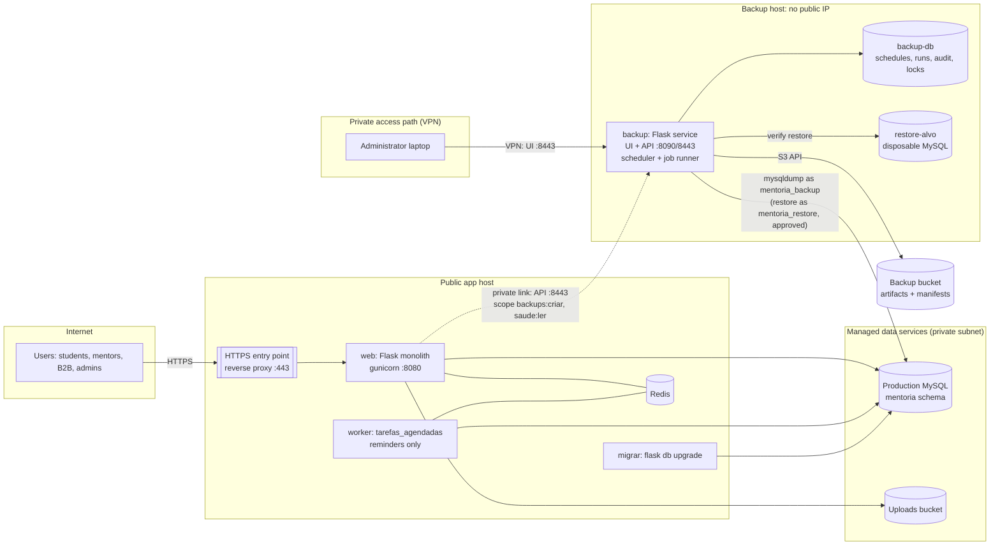
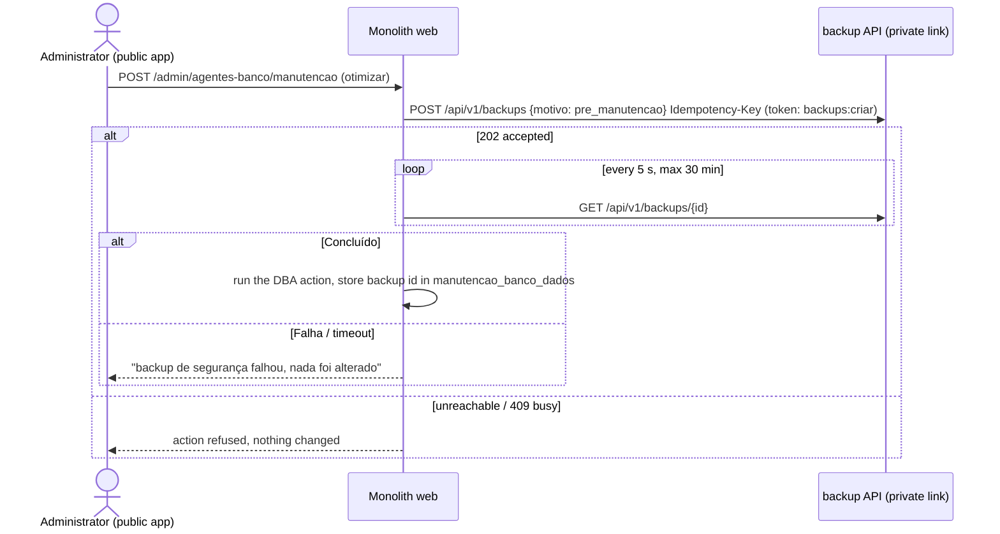

# Phase 2: proposed service boundaries (for approval)

Status: **PROPOSAL, not approved.** Nothing described here has been extracted, deleted, pushed or created.
Base analysed: `origin/cloud-native` @ `eed79cb` (contains all of `main`; see decision D1).
Labels used below: **[verified]** = read in the code or exercised by a test in this session;
**[proposed]** = new contract or behaviour; **[uncertain]** = depends on a decision or on infrastructure not visible in the repo.

---

## 1. What the code shows (evidence for the boundaries)

| Fact | Evidence | Consequence |
|---|---|---|
| One schema, 75 tables, 137 foreign keys, 84 of them to `usuario.id` | `models.py` | The business domain (courses, mentoring, projects/TCC, bancas, meetings, evaluations, notifications, B2B) is one tightly joined data model. Splitting it would mean distributed joins and sagas for every screen. |
| 176 routes in one Flask app, 40 modules import `models` directly | `app.py`, `grep` | One team, one deploy unit, no evidence of independent release cadences. |
| Auth is session-based Flask-Login + bcrypt + TOTP MFA + Google SSO, roles are named rules `PERFIS_*` plus custom profiles gating endpoints by module | `app.py:100-140`, `autenticacao.py`, `perfis_acesso.py` | Every business route depends on the same session and user table. |
| Backup owns **its own 3 tables** and already treats them as *not part of the restored data* | `backup_servico.TABELAS_PRESERVADAS` (`agendamento_backup`, `alteracao_agendamento_backup`, `registro_backup`), `_ler/_gravar_tabelas_preservadas` | The code already wants backup metadata to live outside the database being restored. This is the strongest evidence for a separate data owner. |
| Backup needs privileges no public process should hold: full dump credentials, DDL/restore rights, file system or bucket write, `mysqldump`/`pg_dump` binaries | `backup_servico._dump_mysql/_restaurar_mysql/_restaurar_postgresql`, `Dockerfile` installs `default-mysql-client` in the public image | A public web container compromised today can dump and overwrite the whole database. |
| Scheduled backups can fire from **three** places at once | `before_request verificar_backups_agendados` (every web worker, every 5 min), `rotina_de_backups` thread (`python app.py`), `tarefas_agendadas.executar_backups_agendados` (worker) | Fixed locally with an atomic claim (see §8), but "runs in only one place" needs a single owner. |
| Restore is executed **inside the live web process** and disposes its engine | `backup_servico.restaurar` → `db.session.remove(); db.engine.dispose()` | Production restores should be an out-of-band, approved operation, not a request handler. |
| Backups cover **only the database**; uploaded files (S3/MinIO or `uploads/`) are not backed up | `backup_servico.py` (no reference to `armazenamento`) | Gap to decide (D6). |
| There is no "restore verified" state; only "Concluído" = dump + integrity check | `RegistroBackup.status`, `verificar_integridade` | Required by the brief; new in the service. |
| AI/QA agents are local subprocesses that `import app`, use Playwright and (Orquestrador) edit and commit code in a git checkout | `app.py:8887,9046,…`, `ambiente.disponivel('agentes')` disables them in containers | Tooling coupled to the whole codebase; not a runtime capability. Not a candidate now. |

## 2. Recommendation

**Extract exactly one service now: a private backup and restore service on its own host.** Keep everything else in the
monolith, which stays a modular monolith with two processes it already has (`web`, `worker`).

| Capability | Decision | Business owner | Data owner | Independent deploy? | Ops cost of a split | Verdict |
|---|---|---|---|---|---|---|
| Backup, restore, schedules, backup KPIs, restore verification | **Split** → `mentoria-backup` | System administrator / ops | 3 tables + artifacts, not the business data | Yes: different host, network zone, credentials, release risk | One more service + host + VPN; justified by security isolation | ✅ split |
| Business domain (courses, mentoring, TCC, bancas, meetings, evaluations, B2B, certificates, notifications) | Keep | Pedagogical/B2B management | One shared schema | No | Very high (137 FKs) | ❌ keep together |
| Authentication and authorization | Keep in monolith | Same | `usuario`, MFA, profiles | No | High; every route needs it | ❌ keep; backup gets its **own** admin auth (§5) |
| Scheduled reminders (`tarefas_agendadas.py`) | Keep as monolith `worker` process (already separate process) | Same | Same schema | Already separate process | – | ❌ keep (minus the backup job) |
| Assistant, AI providers, knowledge base | Keep | Admin | Own tables but FK to `usuario` | No evidence | Medium | ❌ keep (revisit if AI costs or scaling diverge) |
| AI/QA agents (OmniTest, security, DB, Orquestrador) | Keep for now | Dev/QA | Reads everything | Needs full codebase + git | High | ❌ keep; candidate to leave the public host later (not in this migration) |
| DBA maintenance actions (`banco_manutencao.py`: ANALYZE/OPTIMIZE/indices) | Keep in monolith, **calls** the backup service for the pre-change backup | Admin | Business DB | No | – | ❌ keep |

## 3. Proposed repositories (under `LK-Plataforma-Mentoria`)

| Repository | Purpose | Contents |
|---|---|---|
| `mentoria-backup` | Private backup and restore service + admin UI | Flask app (same stack and conventions), its own DB + Alembic, engine drivers ported from `backup_servico.py`, rules from `backup_regras.py`, scheduler, job runner with locks, restore verification, bucket storage, REST API, Dockerfile, tests |
| `mentoria-ecossistema` | Ecosystem-level Docker Compose, architecture docs, diagrams, API contracts, runbooks | `docker-compose.yml` (local, all services), `docker-compose.backup-host.yml` (separate host), `docs/` (this proposal turned into the architecture record), `contratos/backup-api.yaml` (OpenAPI) |
| `luiskenji-ido/plataforma-mentoria` (existing) | The monolith | Gains a small backup API client behind a flag, then loses the backup UI/routes/jobs (§7). Whether it moves into the org is decision D2. |

## 4. The backup service (`mentoria-backup`)

- **Responsibility:** create database backups (manual, scheduled, pre-change on request), keep schedules and retention,
  store artifacts, verify restores on a disposable target, restore production (separately approved), expose KPIs,
  keep an audit trail of who did what, with which scope and outcome.
- **Source modules:** `backup_regras.py` (moves as is), `backup_servico.py` (engine drivers, integrity checks, retention,
  CSV export, legacy-schedule migration), `rotas_backup.py` + `templates/admin_banco.html` (UI), `ambiente.pasta_backups*`,
  `ambiente.ferramenta_backup`, the restore check of `agentes_banco/agente_backup.py`, `copiar_banco.py` (SQLite→MySQL/PG restore path).
- **Owned data [proposed]:**
  - its own DB (MySQL 8.4, same engine the team already runs) on the backup host: `agendamento`, `alteracao_agendamento`,
    `execucao` (today `registro_backup`), plus new `trava` (job lock), `verificacao_restauracao`, `aprovacao`, `operador`;
  - artifacts in a **dedicated bucket** (not the uploads bucket), keyed `<pasta>/<arquivo>` exactly like today's
    `BACKUP_DIR/<pasta>/<arquivo>`, plus a JSON manifest per artifact (sha256, size, engine, alembic revision, who/why)
    so history can be rebuilt from storage alone.
- **Dependencies:** production DB (network + dump/restore credentials), backup bucket, disposable restore target
  (a MySQL container on the backup host), SMTP (optional failure alerts).
- **Status model [proposed]:** `Em andamento` → `Concluído` (dump written and integrity-checked, as today) → `Verificado`
  (restored into the disposable target and checked: `usuario` table, row counts per table, alembic revision) or `Falha`.
  The KPI shows "last backup" **and** "last verified backup" separately.
- **Conflicts [proposed]:** one job at a time per target database, enforced by a DB row lock (`trava`, `SELECT … FOR UPDATE`
  with a lease + heartbeat so a crashed job releases it). A second request gets `409 Conflict` with the running job id.
  Scheduled runs keep the atomic claim already added to the monolith.
- **Interfaces:**
  - private admin UI (HTML, same look as today) on port 8090, reachable only through the VPN;
  - private REST API `/api/v1/*` for the monolith (scoped service tokens);
  - `GET /healthz` (liveness), `GET /readyz` (own DB + bucket; production DB reachability reported but **not** required to be ready).

## 5. Preserving authentication, authorization and workflows

- **Who can do what today [verified]:** only `Administrador` (`PERFIS_ADMINISTRACAO_SISTEMA`) and custom profiles with the
  `manutencao` module can open `/admin/banco` and its download and report endpoints; MFA applies per account.
- **Backup service auth [proposed]:** its **own** operator accounts with password + mandatory TOTP (port of `autenticacao.py`),
  not delegated to the monolith. Reason: the monolith's database is what you restore; if it is lost or corrupted you must still be
  able to log in to the backup service. Roles:
  - `auditor`: read KPIs, history, reports;
  - `operador`: manual backup, schedules, verification restores, downloads;
  - `restaurador`: request a **production** restore; it runs only after a second, different `restaurador` approves (four-eyes),
    and only from a backup in state `Verificado`.
  Bootstrap: `flask --app servico operadores criar --papel operador` (CLI on the host; no self-signup).
- **Service-to-service [proposed]:** the monolith holds a token with scope `backups:criar backups:ler saude:ler` only. It can
  request a pre-change backup and read KPIs; it can **never** restore, delete or download. Tokens are HMAC-signed, rotated,
  sent over TLS on the private link; mTLS is optional (D7).
- **Database credentials [proposed]:** two MySQL users on the production DB:
  `mentoria_backup` (SELECT, SHOW VIEW, TRIGGER, EVENT, LOCK TABLES, PROCESS, SHOW_ROUTINE: enough for
  `mysqldump --single-transaction --routines --triggers`), and `mentoria_restore` (full rights on the `mentoria` schema only),
  the second loaded only during an approved production restore. The disposable target has its own throwaway credentials.
- **User-facing workflow after cutover:** the administrator opens the backup UI through the VPN instead of *Sistema ›
  Manutenção (DB)*. Same actions, same fields, same CSV reports, plus "Verificar restauração" and the approval step. The monolith
  menu entry becomes a link that only shows to `Administrador` and explains the VPN requirement (or is removed; D5).

## 6. Communication

### 6.1 Networks and names

- **Local (one machine, `mentoria-ecossistema/docker-compose.yml`):** service DNS names on user-defined networks:
  `rede_publica` (only `web`'s port published), `rede_app` (`web`, `worker`, `migrar`, `db`, `redis`, `minio`),
  `rede_backup` (`backup`, `backup-db`, `restore-alvo`, `backup-migrar`) and `rede_entre_hosts` (`backup`, `db`, `minio`, `web`)
  that **simulates** the private link between hosts. Names: `http://backup:8090`, `db:3306`, `minio:9000`, `restore-alvo:3306`.
- **Production (two hosts) [uncertain: depends on D7]:** Docker DNS does not cross hosts. The backup host has **no public IP**;
  a WireGuard (or cloud VPN / private subnet) link carries: monolith host → `backup.mentoria.interno:8443` (API),
  backup host → production DB `:3306` and backup bucket endpoint, admin laptops (VPN peers) → `backup.mentoria.interno:8443` (UI).
  Security groups / firewall allow only these flows. Names resolve through private DNS (or `/etc/hosts` on the WireGuard peers).

### 6.2 Calls

| # | Caller → callee | Trigger (workflow) | Sync/async | Method + route / event | Timeout, retries, failure behaviour |
|---|---|---|---|---|---|
| 1 | Admin browser → backup UI | Manual backup, schedule edit, history, reports, download | sync | `GET/POST /admin/banco` (same form actions as today), `GET /admin/banco/arquivo`, `GET /admin/banco/relatorio/<tipo>.csv` | UI shows the job state; a long dump runs as a job (no 180 s request timeout). |
| 2 | Monolith (DBA action, `banco_manutencao._backup_antes`; functional-test agent) → backup API | Pre-change backup before ANALYZE/OPTIMIZE/indices | sync start + poll | `POST /api/v1/backups` `{motivo, pasta:"pre_manutencao", solicitante:{id,nome}}` + `Idempotency-Key` → `202 {id}`; `GET /api/v1/backups/{id}` until `Concluído`/`Falha` | Connect timeout 3 s; POST retried 2× with the same key on connect errors only; poll every 5 s up to 30 min. Unreachable, `409`, or `Falha` → **the DBA action is refused, nothing changed** (same rule as today). |
| 3 | Monolith (*Ambiente* page, DB agents, assistant knowledge) → backup API | Show backup KPIs and schedules read-only | sync | `GET /api/v1/saude`, `GET /api/v1/agendamentos` | Timeout 2 s, no retry, cached 60 s; on failure the tile shows "backup service unreachable". Never blocks the page. **[proposed, optional]** |
| 4 | Backup scheduler → production DB | Scheduled run due | async (job) | `mysqldump` over TCP `db:3306` as `mentoria_backup` | DB down: run recorded `Falha`, claim already moved, KPI turns `Crítica`, alert e-mail. Next run at the next due time (no retry storm). |
| 5 | Backup job → bucket | Store artifact + manifest | async (inside job) | S3 `PutObject` (multipart), then `HeadObject` to confirm size and sha256 | 3 retries with exponential backoff; on failure the local staging file is kept and the run is `Falha`. |
| 6 | Backup job → disposable target | "Verificar restauração" (manual) and after each scheduled backup **[proposed]** | async (job) | `mysql` client into `restore-alvo:3306`, then checks | Target reset before each check; failure marks the backup `Concluído` (not `Verificado`) and records why. |
| 7 | Backup job → production DB | Approved production restore | async (job) | Safety backup of the current DB first, then `mysql` restore as `mentoria_restore` | Safety backup fails → restore cancelled. Monolith must be in maintenance (runbook: stop `web`/`worker`, restore, run `migrar`, start). |
| 8 | Backup service → admins (SMTP) | Failure or overdue backup | async | e-mail | Best effort; logged. |

No message broker is proposed: there is a single producer and a single consumer, and the HTTP + polling + idempotency
contract covers the only cross-service workflow (row 2). Adding a broker would be operational cost without a need.

## 7. Diagrams

### 7.1 Components



### 7.2 Manual backup (administrator)

```mermaid
sequenceDiagram
  actor Admin as Administrator (VPN)
  participant BK as backup (UI)
  participant BDB as backup-db
  participant DB as Production MySQL
  participant BB as Backup bucket
  Admin->>BK: POST /admin/banco acao=backup (session + TOTP, role operador)
  BK->>BDB: take lock "trava(mentoria)" (409 if a job holds it)
  BK->>BDB: insert execucao(Em andamento, operator, scope, motivo)
  BK->>DB: mysqldump --single-transaction (mentoria_backup)
  BK->>BK: integrity check (gzip, header, "Dump completed", table usuario)
  BK->>BB: PutObject artifact + manifest (sha256)
  BK->>BDB: execucao = Concluído (size, duration, key); release lock
  BK-->>Admin: "Backup concluído e validado"
  Note over BK,DB: on any failure: execucao = Falha with the reason, lock released, KPI = Crítica
```

### 7.3 Scheduled backup and retention

```mermaid
sequenceDiagram
  participant SCH as backup scheduler (only instance)
  participant BDB as backup-db
  participant DB as Production MySQL
  participant BB as Backup bucket
  loop every 60 s
    SCH->>BDB: SELECT active schedules with proxima_execucao <= now
    SCH->>BDB: UPDATE … SET proxima=next WHERE id=? AND proxima=read (atomic claim)
    alt claim won
      SCH->>BDB: take lock, insert execucao(Agendado)
      SCH->>DB: mysqldump
      SCH->>BB: PutObject + manifest
      SCH->>BB: delete objects beyond retencao (arquivos_excedentes)
      SCH->>BDB: execucao = Concluído; ultima_execucao = now; release lock
    else claim lost (another instance) or lock busy
      SCH->>SCH: skip; next due time already moved
    end
  end
```

### 7.4 Restore verification on a disposable target

```mermaid
sequenceDiagram
  actor Op as Operator (VPN)
  participant BK as backup
  participant BB as Backup bucket
  participant RT as restore-alvo (disposable MySQL)
  participant BDB as backup-db
  Op->>BK: POST /admin/banco acao=verificar (backup id)
  BK->>BDB: lock "trava(restore-alvo)"
  BK->>BB: GetObject + sha256 check against manifest
  BK->>RT: DROP/CREATE schema, load dump
  BK->>RT: checks: tables present, usuario not empty, row counts, alembic revision
  BK->>BDB: verificacao_restauracao(result, durations = RTO estimate); backup status Verificado or stays Concluído with reason
  BK->>RT: drop schema (target left empty)
  BK-->>Op: result
```

### 7.5 Production restore (separately approved)

```mermaid
sequenceDiagram
  actor R1 as Restaurador 1
  actor R2 as Restaurador 2
  participant BK as backup
  participant DB as Production MySQL
  participant APP as Monolith (web, worker)
  R1->>BK: request restore of backup X (must be Verificado) + reason
  BK-->>R2: e-mail "approval required"
  R2->>BK: approve (different person, TOTP re-check)
  Note over APP: Runbook: operator stops web and worker (maintenance)
  BK->>DB: safety backup of current DB (Segurança pré-restauração)
  alt safety backup OK
    BK->>DB: restore X as mentoria_restore
    BK->>BK: audit: who requested, who approved, source, safety copy, outcome
  else safety backup failed
    BK->>BK: restore cancelled, audit Falha
  end
  Note over APP: Runbook: run migrar (flask db upgrade), start web and worker; app applies atualizar_estrutura_banco at import
```

### 7.6 Pre-change backup requested by the monolith



## 8. Local refactor done in Phase 1 (branch `refatoracao-fase1`, not pushed)

| Change | Files | Why |
|---|---|---|
| Pure backup rules module (no Flask/DB/disk): schedule validation, next run, retention selection, health classification, file prefixes | `backup_regras.py` (new), `backup_servico.py` delegates, same public names | Separates business rules from infrastructure; moves unchanged into the service. |
| Backup routes moved out of `app.py` (−215 lines) into one module, **same URLs and endpoint names**, one handler per form action | `rotas_backup.py` (new), `app.py` registers it | Clear boundary; Phase 3 removal = delete one module and one registration line. |
| **Bug fix:** atomic claim for due schedules (conditional UPDATE): two processes can no longer run the same due backup | `backup_servico.reservar_execucao` | Three scheduler entry points could double-run a backup. |
| **Bug fix:** `mysqldump`/`mysql` now connect over TCP like the app (PyMySQL) unless the URL has `unix_socket` | `backup_servico._arquivo_de_credenciais` | With `DATABASE_URL=…@localhost…` and MySQL reachable only over TCP (Docker port, tunnel), backup and restore failed while the app worked. Reproduced by the new integration test before the fix. |
| **Bug fix:** `.gitattributes` treated `deploy/**` binaries (`.docx`, `.png`) as text and rewrote CRLF bytes | `.gitattributes` | Fresh clones showed modified binaries; commits could corrupt them. |
| Tests: 26 unit tests (incl. 400 randomized next-run cases against a brute-force reference), 9 MySQL integration tests for the backup routes, permissions, retention, the atomic claim and an end-to-end restore on the disposable test DB | `tests/unit/test_backup_regras.py`, `tests/integration/test_backup_http.py` | Characterises current behaviour before extraction. |
| CI format list and agent file hints updated | `.github/workflows/ci.yml`, `agentes_omnitest/*.py` | Keep tooling pointing at the right files. |

Deliberately **not** changed (deferred to the approved migration): scheduler entry points, database ownership of the 3 tables,
removal of the backup UI, permissions in `perfis_acesso.MODULOS['manutencao']`, the "Zona de perigo" data wipe.

## 9. Migration sequence (small, verifiable increments)

| Step | What | Done when (verification) | Rollback |
|---|---|---|---|
| M1 | Create `mentoria-ecossistema`: contracts (OpenAPI), compose skeleton, this document as the architecture record | Repo created, docs render, `docker compose config` valid | Delete repo |
| M2 | Create `mentoria-backup`: port rules/drivers, own DB + Alembic, auth + roles + TOTP, job runner + locks, bucket storage, `Verificado` state, UI, API, health, Dockerfile, tests | Unit + integration tests green; `docker compose up` local: create backup, schedule, KPI, verify restore into `restore-alvo` | Nothing in production uses it yet |
| M3 | Import command: copy the 3 tables and existing artifacts (`BACKUP_DIR/<pasta>/…`, `BACKUP_DIR_EXTERNO`) into the service; idempotent; user ids kept + name/e-mail snapshot | Row counts and sha256 of every artifact match; retention still finds `mentoria_backup_ag<id>_` files | Re-run is idempotent; source untouched (read-only) |
| M4 | Shadow run on the backup host, **service scheduler off**: manual backups + verification restores against a copy with representative data | ≥ 1 backup `Verificado`; RTO recorded | Stop the service |
| M5 | Monolith: `BACKUP_SERVICO_URL` + client; pre-change backup and KPIs use the API when set | Integration test with a fake service; DBA action refused when service down | Unset the variable |
| M6 | **Scheduler cutover (one switch):** monolith `BACKUP_AGENDADOR=servico` disables all 3 entry points; enable the service scheduler | Next due window: runs appear only in the service history; monolith logs show the job skipped | Flip both flags back |
| M7 | Remove from the monolith: `rotas_backup.py`, `admin_banco.html`, menu items, `manutencao` endpoints in `perfis_acesso`, backup job in `tarefas_agendadas`, `before_request` hook, thread, `instalar.py` default schedules, `mysql-client` from the public image | Old URLs return 404 for every role (test); public image has no `mysqldump`; e2e green | `git revert` + flags back; tables were kept |
| M8 | Drop the 3 old tables via Alembic after a retention window **(separate approval)** | Migration applied | Restore tables from the last pre-drop backup |

Production steps (host creation, VPN, DB users, bucket, M6 in production, M8) each need your separate go-ahead.

## 10. Unresolved decisions

| # | Decision | Recommendation |
|---|---|---|
| D1 | Base branch: `cloud-native` (19 commits ahead, has tests/CI/containers, unmerged) or `main` | `cloud-native`; merge it to `main` first or base everything on it |
| D2 | Monolith repository: stay at `luiskenji-ido/plataforma-mentoria` or move into the org | Stay for now (no history/issue disruption); I need **push access** there to publish branches (this session has read-only) |
| D3 | Backup service auth: own operator accounts + TOTP (recommended) vs delegated to the monolith | Own accounts (works when the main DB is the thing that is broken) |
| D4 | Production restore: four-eyes approval in the service | Yes |
| D5 | "Zona de perigo" (wipe data except my account): move to the private service, keep in the monolith, or drop | Move to the private service under `restaurador` + four-eyes, or drop |
| D6 | Include uploaded files (uploads bucket) in backup scope | Yes, via bucket versioning + replication to the backup bucket (no app code), or a sync job in the service |
| D7 | Private access path and host: WireGuard on an EC2 in a private subnet, cloud VPN/SSM, Tailscale…; mTLS on the API | WireGuard + private subnet + security groups; TLS with an internal CA, mTLS optional |
| D8 | Backup metadata store | MySQL 8.4 on the backup host + manifests in the bucket |
| D9 | Supported engines in the service: MySQL only, or also PostgreSQL and SQLite (all supported today) | Port all three drivers (code exists); test MySQL in CI, others as unit tests |
| D10 | Language of new code and READMEs | Portuguese (repo convention, `AGENTS.md`); this proposal is in English because you wrote to me in English |

**Approval requested:** the single-service split, the two new repositories (`mentoria-backup`, `mentoria-ecossistema`),
the migration order M1–M7, and answers to D1–D10 (or "use your recommendations").
