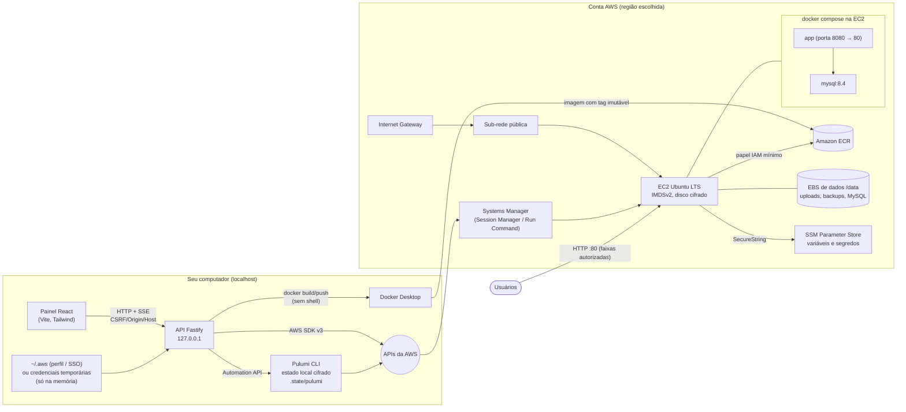

# Painel de Infraestrutura (AWS EC2 + Pulumi + Docker)

Painel local para provisionar, publicar, monitorar e destruir a infraestrutura da plataforma Mentoria na AWS:
uma EC2 com Ubuntu Server LTS, Docker instalado pelo cloud-init e a aplicação rodando em contêiner (com MySQL),
tudo criado pelo **Pulumi (TypeScript) pelo Automation API** — sem Terraform.

```bash
cd infrastructure
npm install
npm run dev        # abre http://localhost:3000
```

> **Nada é criado na AWS sem prévia e confirmação.** Salvar a configuração não cria recursos; provisionar exige a
> prévia da configuração exata (válida por 30 min), digitar o nome do stack e aceitar os custos.

---

## 1. Arquitetura



| Pasta | O que tem |
|---|---|
| `packages/shared` | Schemas **Zod** (configuração, conexão AWS) e tipos usados por API, painel e Pulumi |
| `pulumi/` | Programa Pulumi e componentes: rede (VPC, sub-rede, IGW, rotas), Security Group, ECR, IAM, SSM, EBS, EC2; `bootstrap/` gera o cloud-init, o compose e os scripts fixos |
| `apps/api` | API Fastify: credenciais (`aws/`), catálogo e preços, Pulumi (`pulumi/`), fluxos de deploy (`deployment/`), rotas (`routes/`) |
| `apps/web` | Painel React + Vite + Tailwind + Lucide (tema escuro opcional) |
| `scripts/doctor.mjs` | Confere os pré-requisitos (não instala nada) |
| `.state/` | **Estado local** (configuração sem segredos, estado do Pulumi cifrado, logs mascarados). Fora do Git. |

**Aplicação detectada:** Flask/gunicorn em Python 3.12 (`deploy/conteiner/Dockerfile`), porta **8080**, MySQL
(`DATABASE_URL`), pastas persistentes `/app/uploads` e `/app/instance`, segredos `SECRET_KEY`, `MAIL_*` e chaves das
IAs. O Dockerfile atual não tem `HEALTHCHECK`: o painel define um no compose da EC2 (configurável).

## 2. Pré-requisitos

| Ferramenta | Para quê | Instalação (Windows) |
|---|---|---|
| Node.js 20+ (testado no 26) | painel e API | `winget install OpenJS.NodeJS.LTS` |
| Pulumi CLI 3.x | provisionamento | `winget install Pulumi.Pulumi` |
| Docker Desktop (WSL 2) | gerar e enviar a imagem | https://www.docker.com/products/docker-desktop/ |
| AWS CLI v2 | só para o login SSO | `winget install Amazon.AWSCLI` |
| Git | marca a imagem com o commit | — |

`npm run doctor` mostra o que falta. A tela **Configurações** mostra o mesmo.

> **Google Drive:** não rode `npm install` dentro de uma pasta sincronizada pelo Google Drive (`G:\Meu Drive`):
> o sistema de arquivos dele não aguenta o `node_modules` (falha com EBADF). Use um clone ou `git worktree` em disco
> local (ex.: `C:\Users\<você>\dev\mentoria-infra`).

## 3. Instalação e início

```bash
cd infrastructure
npm install
npm run dev     # API em 127.0.0.1:3001 + painel (Vite) em http://localhost:3000
```

Modo "produção" local (painel já compilado, tudo na porta 3000): `npm start`.

## 4. Conectar a AWS (Credenciais AWS)

- **Perfil da AWS CLI** (recomendado): `aws configure --profile mentoria`, escolha o perfil na tela.
- **SSO (IAM Identity Center):** `aws configure sso`, escolha o perfil SSO e clique em **Entrar com SSO** (abre o
  login oficial no navegador; o painel nunca vê senha).
- **Credenciais temporárias:** Access Key + Secret + Session Token. Ficam **só na memória da API**.

**Testar conexão com a AWS** chama `sts:GetCallerIdentity` e mostra conta, identidade e região. A conta **root** é
recusada.

Permissões mínimas do usuário/papel que provisiona: EC2 (VPC, sub-redes, IGW, rotas, SG, instâncias, volumes),
IAM (criar o papel e o instance profile da EC2 e `iam:PassRole` para ele), ECR, SSM (parâmetros e Run Command),
CloudWatch (leitura de métricas), Pricing (leitura) e STS.

## 5. Escolher a EC2 (Configuração da EC2)

Região, nome, tipo (lista da API EC2 com vCPU, memória e arquitetura), **Ubuntu Server LTS** (22.04/24.04/26.04 —
só as que a Canonical publica na região) e disco raiz (gp3 cifrado por padrão, mínimo 8 GiB, recomendado 20).
A AMI é resolvida na hora pelos parâmetros públicos da Canonical no SSM
(`/aws/service/canonical/ubuntu/server/<versão>/stable/current/<arch>/hvm/ebs-gp3/ami-id`) e conferida
(dona `099720109477`). Nenhum ID de AMI é fixo no código.

**Arquitetura:** a imagem é gerada para a arquitetura escolhida (`linux/amd64` ou `linux/arm64`). x86_64 (t3/t3a) é o
padrão; arm64 (t4g) é mais barato, mas o build usa emulação e todas as dependências precisam ter versão arm64.

## 6. Armazenamento, rede e aplicação

- **Volumes de dados (EBS):** cifrados, separados da instância, montados pelo UUID (`nofail`) e preservados no
  destroy por padrão (`retainOnDelete`). Só apagados se você marcar a opção do volume.
- **Rede:** VPC nova (Internet Gateway → sub-rede pública → EC2) ou existente. Sem NAT Gateway nem Load Balancer.
- **Security Group:** só a porta do app (faixas que você autorizar). **SSH fechado por padrão**; quando aberto, só
  de IPs específicos (0.0.0.0/0 é recusado). Administração pelo **Session Manager**.
- **Docker e aplicação:** Dockerfile e contexto (dentro do repositório), portas, caminho de saúde, política de
  reinício, variáveis (segredos marcados), pastas persistentes e o MySQL em contêiner.

## 7. Provisionar (Prévia → Provisionamento)

1. **Prévia da infraestrutura**: `pulumi preview` + resumo (região, tipo, Ubuntu, discos, rede, portas, imagem),
   lista de recursos e **estimativa de custo**.
2. **Provisionar infraestrutura**: digite o nome do stack e confirme os custos. Passos ao vivo (SSE):
   credenciais → configuração → segredos → **build da imagem** (antes de criar qualquer recurso) → `pulumi up`
   (VPC, sub-rede, SG, IAM, ECR, SSM, EBS, EC2) → push ao ECR (tag imutável `AAAAMMDD-HHMMSS-<commit>`) → registro
   da versão no SSM → espera o Systems Manager → espera o cloud-init (Docker instalado) → `deploy.sh` pelo Run
   Command → verificação HTTP de saúde.

O bootstrap (cloud-init) atualiza o Ubuntu, instala o Docker Engine e o plugin Compose do repositório oficial, a
AWS CLI (snap), monta os volumes, grava o `docker-compose.yml`, os scripts fixos e a unidade `app.service`
(a aplicação volta sozinha depois de reiniciar). **Nenhum segredo vai no user data**: a instância lê as variáveis do
SSM (SecureString) pelo papel IAM, no deploy.

## 8. Publicar uma nova versão

**Provisionamento › Publicar nova versão** (ou Instâncias › Publicar de novo): build → push com tag nova → registro →
`deploy.sh` → saúde. A imagem é gerada com o código **atual do seu computador** (a tag ganha `-dirty` se houver
mudanças não commitadas).

## 9. Monitorar (Instâncias e monitoramento)

Estado real: EC2 (SDK), verificações da AWS, Systems Manager, Docker e contêineres (script fixo `status.sh` pelo Run
Command), HTTP público e CPU (CloudWatch). Saúde: **Running / Degraded / Stopped / Unknown**, sempre com base nas
verificações. Logs do app e do bootstrap por comandos **fixos** (não há execução de comando livre).

## 10. Parar a EC2 × destruir

- **Parar**: a instância para de cobrar por hora; **EBS, ECR e eventuais IPs fixos continuam cobrando**. O IP público
  automático muda ao ligar de novo.
- **Destruir infraestrutura**: `pulumi destroy` remove EC2, rede, SG, IAM, SSM e ECR (com as imagens). Exige digitar
  `destruir <stack>`. Volumes de dados preservados continuam na conta até você apagá-los.

## 11. Solução de problemas

| Sintoma | O que fazer |
|---|---|
| "Defina a senha do estado do Pulumi" | Configurações › senha (ou `PULUMI_CONFIG_PASSPHRASE`). Guarde-a: sem ela o stack não pode ser alterado. |
| Credenciais expiradas / SSO | Reconecte em Credenciais AWS (Entrar com SSO). |
| "O Docker não está rodando" | Abra o Docker Desktop e espere "Engine running". |
| Instância não aparece no Systems Manager | Espere alguns minutos; confira IP público e rota para o Internet Gateway. |
| Bootstrap não termina | Instâncias › Log do bootstrap (`/var/log/app-bootstrap.log`). |
| App não responde | Instâncias › Logs do app; confira porta, caminho de saúde e variáveis. |
| Falha no meio do provisionamento | O estado guarda o que foi criado: corrija e provisione de novo (cria só o que falta). "Sincronizar estado" se algo foi mudado no console. |

Os logs de todas as operações ficam em `.state/logs/*.jsonl` (sempre mascarados) e em **Logs e diagnóstico**.

## 12. Custos

A tela mostra EC2 e EBS pela **AWS Price List API** (consultada na hora) e, com data, os valores públicos
documentados para IPv4 público (US$ 0,005/h), armazenamento do ECR (US$ 0,10/GB-mês) e transferência (supõe
< 100 GB/mês de saída, faixa gratuita). É uma **estimativa**: impostos, créditos de CPU das instâncias t*,
snapshots, tráfego e mudanças de preço alteram a fatura real.

## 13. Segurança

- API e painel **só em 127.0.0.1**; `Host` conferido (contra DNS rebinding); pedidos que mudam algo exigem `Origin`
  do painel, token CSRF por execução e JSON; sem CORS; CSP e cabeçalhos de segurança.
- Credenciais da AWS: perfis/SSO lidos pelo SDK; temporárias **só na memória**; nunca no navegador, em disco, em
  logs ou nas respostas; passadas ao Pulumi só no ambiente do processo filho. Root recusado.
- Segredos da aplicação gerados (`SECRET_KEY`, senhas do MySQL) e informados ficam **cifrados** no estado do Pulumi
  (provedor `passphrase`; sem senha nada roda) e viram **SecureString** no SSM. Nunca no user data.
- Processos externos (`docker`, `git`, `aws`) sem shell, com argumentos separados; senha do ECR pelo stdin.
- Entradas validadas com Zod (nomes, CIDRs, caminhos, portas, variáveis); caminhos de build presos ao repositório;
  o script de bootstrap recusa qualquer valor fora do padrão esperado.
- IAM mínimo na EC2: pull só do repositório do app, leitura só dos parâmetros do stack + Session Manager.
- EC2 com IMDSv2 obrigatório, discos cifrados, SSH fechado por padrão, Docker API nunca exposta.
- **Estado local:** `.state/pulumi` usa o backend em arquivo. Faça backup da pasta `.state` (sem ela o Pulumi não
  consegue alterar nem destruir os recursos). O painel impede duas operações no mesmo stack ao mesmo tempo, mas não
  há trava entre computadores: gerencie cada stack de um só lugar (para equipes, use um backend S3 com trava).

## 14. Testes e verificações

```bash
npm run typecheck   # TypeScript em todos os pacotes
npm run lint        # ESLint (proíbe shell: true e eval)
npm test            # Vitest: schemas, bootstrap/IAM, programa Pulumi com mocks, credenciais, segurança da API,
                    # fluxos de provisionamento com AWS/Pulumi/Docker simulados, componentes React
npm run build       # painel (Vite) + API (tsup)
npm run check       # tudo acima, em ordem
```
